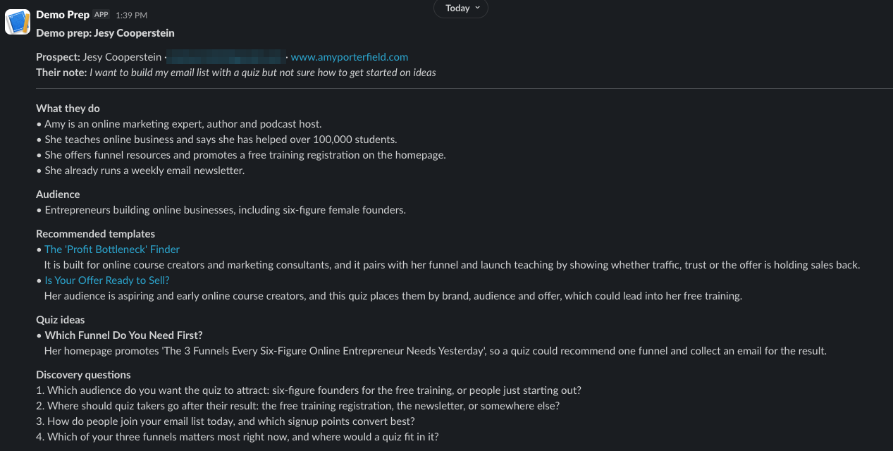
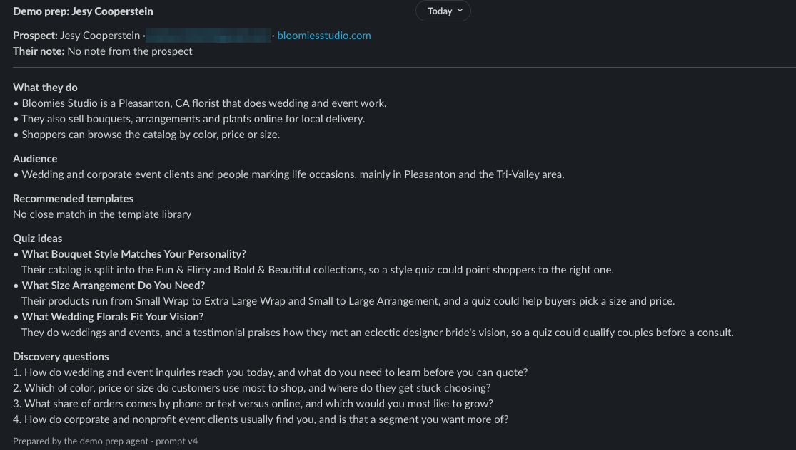

# Demo Call Prep Agent

An AI agent that preps customer success reps for demo calls. When a prospect books a demo on Calendly, the agent reads their website, matches them to real quiz templates, and posts a short prep brief to Slack. The rep doesn't have to run anything.



**Why:** reps spend 10–25 minutes prepping each demo, and up to 6 demos on a busy day. The slowest part is finding a template to show out of 800+. On busy days, prep gets skipped.

## What the brief includes

- **Prospect** and their booking note
- **What they do** and **audience**, based only on their website
- **Recommended templates** from our public template library, each with a reason tied to their site or note
- **Quiz ideas** when no template is a strong match
- **Discovery questions** about their business
- **Flags**, only when something changes how the rep handles the call (for example, the site couldn't be read)

## How it works

1. **Booking:** the agent checks the Calendly account for new bookings and reads the name, email, website, and note.
2. **Website:** it fetches the homepage (and About page if linked) and strips it down to readable text.
3. **Claude:** the current prompt (`prompts/v4.txt`) gets the booking, the site text, and the template library, and returns the brief as JSON.
4. **Checks:** the code removes any template that isn't in `templates.json`, and checks that every quote Claude used as evidence actually appears on the site or in the note. Anything that fails is flagged.
5. **Slack:** the brief is posted to a channel through a webhook.

## Prompts

All prompt versions are in [`prompts/`](prompts/). The agent uses **v4**. The full story of what broke and how I fixed it is in the [build log](build-notes.md).

| Version | What changed | Why |
| --- | --- | --- |
| [v1](prompts/v1.txt) | One line: "Research this company and suggest quiz ideas" | Baseline. Output was long, made up quiz ideas, and guessed at the audience |
| [v2](prompts/v2.txt) | Added the template library, required an exact quote for every claim, JSON output | Ground the brief in the site and our real templates |
| [v3](prompts/v3.txt) | Quotes must be copied character for character | v2 reworded the prospect's note inside a "quote"; the code caught it |
| [v4](prompts/v4.txt) | Templates only when they're a strong match, quiz ideas otherwise; quotes used for checking, not shown; fewer flags | v3 recommended a cupcake quiz to a florist because it had to pick 2–3 templates |

## Sample input and output

- **Input:** [`bookings/sample1.json`](bookings/sample1.json)
- **Output:** every run is saved in [`outputs/`](outputs/). For example:
  - [v1 on a fitness coach](outputs/20261029-125418_v1_nicholastrigili.com.md)
  - [v3 on a florist](outputs/20261029-132653_v3_bloomiesstudio.com.md) (the cupcake recommendation)
  - [v4 on the same florist](outputs/20261029-133925_v4_bloomiesstudio.com.md) (no close template, so quiz ideas)
  - [v4 on a cyber insurance company](outputs/20261029-133941_v4_cowbell.insure.md)



## Running it

This prototype uses external APIs for the language model (Claude), Slack delivery, and Calendly bookings. For security reasons, credentials are not included in this repository. To run it, add your own keys using the included `creds.example.json`.

1. Install Python 3.11+ and the requirements:
   ```
   pip install -r requirements.txt
   ```
2. Copy `creds.example.json` to `creds.json` and fill in:
   - `anthropic_api_key`: a Claude API key
   - `claude_model`: e.g. `claude-sonnet-5-5`
   - `slack_webhook_url`: a Slack incoming webhook for the channel to post to
   - `calendly_token`: a Calendly personal access token (only needed for `--watch`)
3. Run it:

| Command | What it does |
| --- | --- |
| `python3 prep_brief.py --watch` | Checks Calendly every 2 minutes and preps each new booking |
| `python3 prep_brief.py --watch --once` | Checks Calendly one time |
| `python3 prep_brief.py --sample bookings/sample1.json` | Runs a saved booking and posts to Slack |
| `python3 prep_brief.py --name "..." --email "..." --website "..." --note "..."` | Runs one booking from the command line |
| `--dry-run` | Prints the brief in the terminal instead of posting to Slack |
| `--prompt v1` | Uses an earlier prompt version, to compare |

## Prototype scope

- Uses 40 of our 800+ public templates, each summarized in one line. With the full library, Claude would search our template database for the prospect's industry instead of reading every template.
- Runs as soon as a booking comes in. In production it would post 30 minutes before the call and run on a server.
- Built with personal test accounts for Calendly and Slack. No company or customer data is used.

## Files

```
prep_brief.py         the agent
prompts/              prompt versions v1–v4
templates.json        the template library (40 public templates)
bookings/             sample booking
outputs/              saved briefs from every run
docs/                 screenshots
creds.example.json    the keys you need (copy to creds.json)
requirements.txt
```
